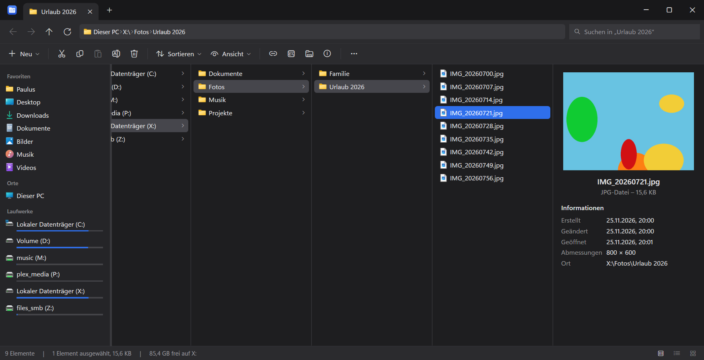

<p align="center">
  
</p>

<h1 align="center">Fundus</h1>

<p align="center">
  A fast file manager for Windows 11 with <b>column view</b> (Miller columns) – the one feature Explorer never got.<br>
  WPF · .NET 10 · no dependencies
</p>

<p align="center"></p>

---

## Why

Explorer only shows one folder at a time. In a column view every subfolder opens to the right, so you always see the whole path you came from – and you can jump back up with one click. Fundus brings that to Windows, while still feeling like a Windows app: tabs in the title bar, a Win11-style command bar, dark menus and the native shell context menu.

## Features

- **Three views** – Columns, Details and Icons (`Ctrl+1/2/3`), with shell thumbnails and a virtualized tile panel for huge folders
- **Tabs** in the title bar (`Ctrl+T`, `Ctrl+W`, `Ctrl+Tab`)
- **Breadcrumb address bar** with dropdown submenus; `Ctrl+L` to type a path
- **Quick Look** – press `Space` to preview images, text and more
- **Preview column** with file details
- **"This PC" home page** – quick access tiles, drives with fill level, recently used files (each section can be hidden via right-click)
- **Sidebar** – favorites (pin with `Ctrl+D` or drag & drop), drives
- **Recursive search** in the current folder (`Ctrl+F`)
- **Explorer-compatible clipboard** – copy/cut/paste between Fundus and Explorer, delete to Recycle Bin
- **Native Windows context menu** (`Shift+Right-click`), drag & drop, live refresh via `FileSystemWatcher`
- **Optional default file manager** – folder double-clicks open in Fundus; a low-level keyboard hook makes `Win+E` open Fundus too (Windows 11 ignores the registry for that), tray icon and optional autostart
- Single instance: opening a folder while Fundus runs adds a new tab

## Keyboard shortcuts

| Keys | Action |
|---|---|
| `←` `→` `↑` `↓` | Move through columns |
| `Space` | Quick Look |
| `Enter` | Open |
| `F2` / `Delete` | Rename / move to Recycle Bin |
| `Ctrl+1` `Ctrl+2` `Ctrl+3` | Columns / Details / Icons |
| `Ctrl+T` / `Ctrl+W` / `Ctrl+Tab` | New tab / close tab / next tab |
| `Ctrl+L` | Type a path |
| `Ctrl+F` | Search |
| `Ctrl+D` | Pin selection to sidebar |
| `Ctrl+Shift+N` | New folder |
| `Ctrl+Shift+C` | Copy path |
| `Ctrl+H` | Show/hide hidden files |
| `Alt+←` / `Alt+→` / `Alt+↑` | Back / forward / up |
| `Alt+Enter` | Properties |
| `F5` | Refresh |

## Build & run

Requires Windows 10/11 and the [.NET 10 SDK](https://dotnet.microsoft.com/download).

```powershell
git clone https://github.com/GamingPaule/Fundus.git
cd Fundus
dotnet run -c Release
```

Install as a standalone app:

```powershell
dotnet publish -c Release -o "$env:LOCALAPPDATA\Programs\Fundus"
```

## Make it the default file manager

Open the `⋯` menu in Fundus and enable **"Fundus als Standard-Dateimanager"** and **"Win+E öffnet Fundus"**.
Everything is written to `HKEY_CURRENT_USER` only – no admin rights needed.

To go back to Explorer at any time:

```powershell
Fundus.exe --unregister
```

## Notes

- The UI is currently in **German**.
- Fundus is a hobby project and not affiliated with Microsoft or Apple. Use at your own risk – file operations go through the regular Windows shell APIs (Recycle Bin included).
- The logo is generated by `Assets/make_logo.py` (Pillow).

## License

[MIT](LICENSE) © 2026 Paul Hohmann

---

### 🇩🇪 Kurz auf Deutsch

Fundus ist ein Dateimanager für Windows mit Spaltenansicht wie im Mac-Finder, aber mit Windows-Optik: Tabs, Befehlsleiste, Brotkrumen-Adressleiste, Quick Look per Leertaste, Startseite „Dieser PC“ und auf Wunsch Standard-Dateimanager inklusive Win+E. Bauen mit `dotnet run -c Release`, zurück zum Explorer mit `Fundus.exe --unregister`.
